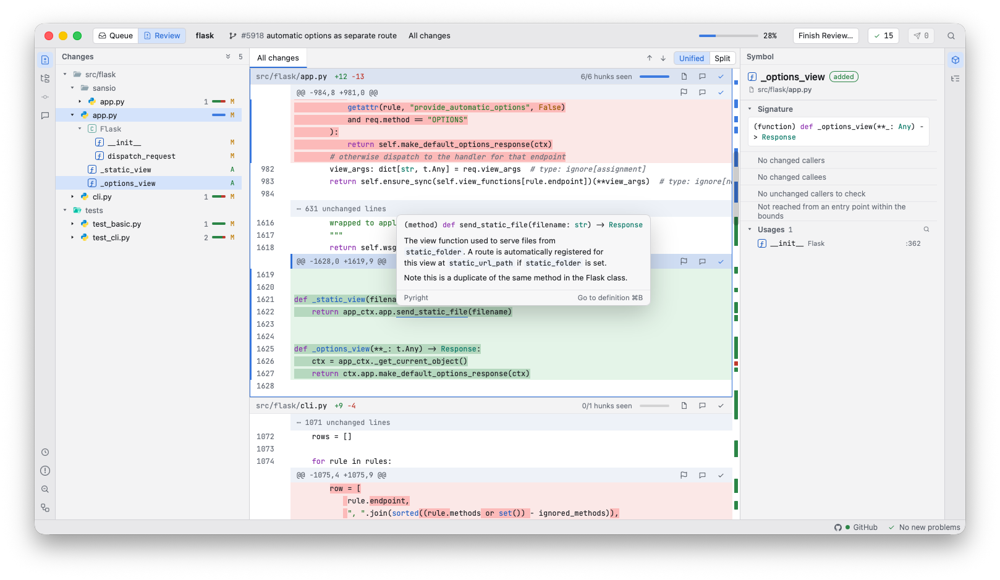

# Vet

<p align="center">An Integrated Review Environment for the agentic age.</p>



Vet helps doing code reviews by providing a review-first code environment with
full code analysis (your beloved type hints still work) while having
first-party support for review flows: mark files as seen or flag them for
later, draft review comments and view CI pipeline results.

## Features

- **Review queue.** Pull Requests, local branches, or working trees, to find
  what to review next.
- **Real code intelligence on both sides of the diff.** Go to definition,
  references, hover, call hierarchy, symbols and diagnostics come from the
  languages' own LSP servers, for the base as well as the changed code.
- **Problems introduced by the changeset.** Find which problems were introduced
  by the changes you're looking at.
- **Draft review comments before posting them.** You can write and rewrite your
  review comments to your heart's content without anyone else seeing them until
  you hit *publish*.

## Status

Vet is a personal tool in active development, not released. It runs on macOS
and Windows.

## Building and running

You need a Rust toolchain that supports edition 2024 (1.85 or newer), Node.js
and pnpm. To use code intelligence for a language, its language server has to
be installed.

```sh
cargo build --workspace
cd ui && pnpm install && pnpm tauri dev
```

Vet keeps its state in the platform's data directory.

## FAQ

### Which Git hosts are supported?

At the moment, only GitHub and Azure DevOps.

### Why build this?

Because why *not* build this? Given how much code agents write these days,
the burden of reviewing this code has increased exponentially, but most of
the widely available tooling is still built for a manual workflow where
*writing* code is the hardest part of programming, not *reading* it. *Vet*
is an attempt to explore a solution to this.

### Is it an Electron app?

Despite the UI being built in TypeScript (using Svelte), there is no full
Chromium instance that is being shipped. Instead, *Vet* is built with
[Tauri](https://github.com/tauri-apps/tauri) which uses your OS's native
webview, while the backend is written in Rust.

### Was this vibe-coded?

Let's say, it was vibe-engineered. No, I didn't read every single line of code
that went into this project. No, that doesn't mean that *Vet* will fall apart
at the slightest of touches. (Though it might, while still in development. Use
at your own risk.) We're all still figuring this out, okay?
